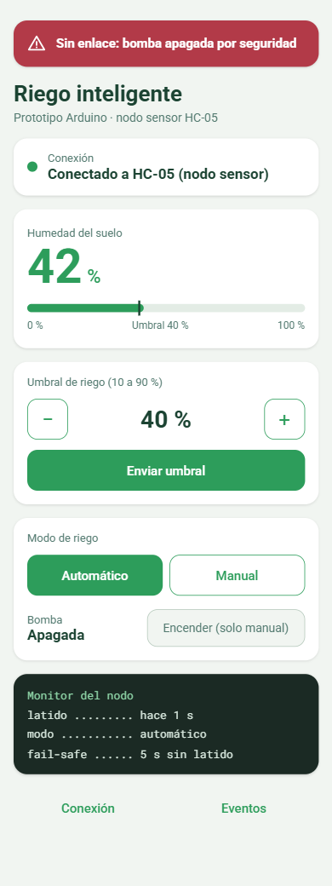
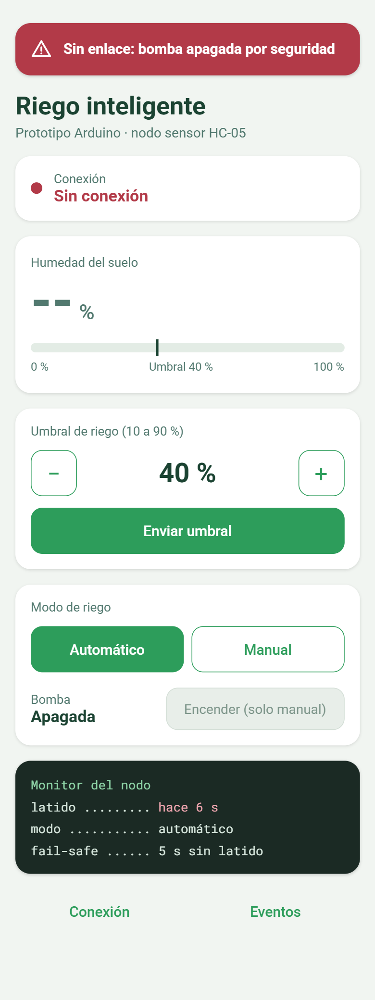
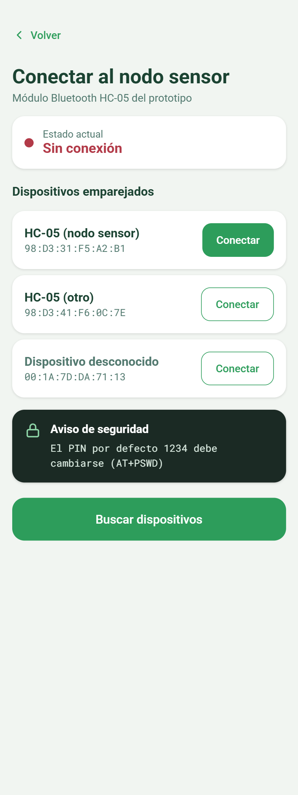
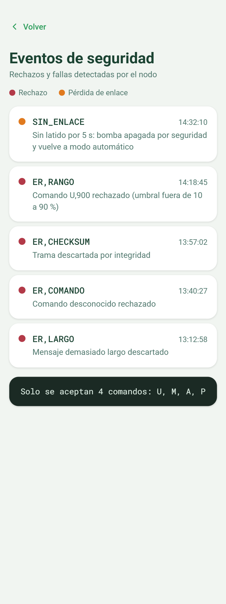

# EVA1 · Prototipo Arduino con conexión inalámbrica

**Asignatura:** Aplicaciones Móviles para IoT (TI3V42) · INACAP Apoquindo

## Contenido
1. [Integrantes y caso elegido](#1-integrantes-y-caso-elegido)
2. [Estructura del repositorio](#2-estructura-del-repositorio)
3. [Tabla de componentes](#3-tabla-de-componentes)
4. [Diagrama de conexión](#4-diagrama-de-conexión)
5. [Formato del mensaje serial](#5-formato-del-mensaje-serial)
6. [Configuración de los HC-05](#6-configuración-de-los-hc-05)
7. [Brechas de seguridad y medidas aplicadas](#7-brechas-de-seguridad-y-medidas-aplicadas)
8. [Prácticas de la industria OT](#8-prácticas-de-la-industria-ot)
9. [Cómo compilar y probar](#9-cómo-compilar-y-probar)
10. [Mockup de la app Android (EVA2)](#10-mockup-de-la-app-android-eva2)

## 1. Integrantes y caso elegido
- Winderson Castrillo
- [Integrante 2]

**Caso:** humedad de sustrato y riego (agricultura de precisión). Un sensor mide la humedad del suelo y una bomba riega cuando baja del umbral. Un segundo microcontrolador recibe las lecturas y puede cambiar el umbral o encender y apagar la bomba a distancia.

```
 NODO SENSOR (Arduino UNO #1)                   NODO CONTROL (Arduino UNO #2)
 Sensor YL-69 ─┐                                   ┌─ Monitor Serie (PC)
 Relé + bomba ─┼─ Arduino ── HC-05 (esclavo) <~BT~> HC-05 (maestro) ── Arduino ─┤
               └                                   └─ LED pin 13 (enlace caído)
```

## 2. Estructura del repositorio

| Ruta | Contenido |
|---|---|
| `firmware/nodo_sensor/` | Sketch del nodo sensor: lee humedad, controla la bomba, valida comandos |
| `firmware/nodo_control/` | Sketch del nodo de control: muestra lecturas y envía comandos |
| `docs/` | Diagrama de conexión |
| `mockup/` | Capturas del mockup de la app Android y sus XML (`mockup/xml/`) |

## 3. Tabla de componentes

| Componente | Voltaje | Interfaz / protocolo | Rango o alcance | Por qué sirve para el caso |
|---|---|---|---|---|
| Arduino UNO R3 (x2) | 5 V (USB o jack) | UART, GPIO, ADC de 10 bits | ADC 0 a 1023 | Simple y robusto. Tiene ADC para el sensor analógico y pines para relé y Bluetooth. No trae radio, por eso se usa HC-05. |
| Sensor de humedad de suelo YL-69 con módulo LM393 | 3,3 a 5 V | Salida analógica (AO) | 0 a 1023 (seco = alto), se convierte a 0 a 100 % | Mide la humedad del sustrato, que es la variable del caso. La salida analógica permite un umbral configurable. |
| Módulo relé SRD-05VDC | 5 V de bobina | Pin digital (activo en bajo en la mayoría) | Hasta 10 A en 250 V AC | Aísla la bomba del Arduino. Un pin del Arduino no puede alimentar la bomba directamente. |
| Mini bomba de agua DC | 3 a 6 V (fuente propia) | Se conmuta con el relé | Según modelo | Es el actuador de riego. |
| HC-05 (x2: maestro y esclavo) | 5 V de alimentación, lógica de 3,3 V | Serial UART, 9600 baudios | Unos 10 m | Funciona como un cable serial invisible entre los dos nodos. |
| Divisor de voltaje 1 kΩ + 2 kΩ (x2) | n/a | n/a | 5 V a 3,3 V | El RX del HC-05 trabaja a 3,3 V y el pin 11 del Arduino entrega 5 V. |
| LED + resistencia 220 Ω | unos 2 V | Pin digital 13 | n/a | Avisa en el nodo de control si se cae el enlace. |

## 4. Diagrama de conexión


> Tinkercad no incluye el HC-05 ni el módulo relé SRD-05VDC, así que en el diagrama se representan con componentes equivalentes y rotulados.

**Nodo sensor**

| Pieza | Pin del componente | Pin del Arduino / destino |
|---|---|---|
| YL-69 | VCC · GND · AO | 5V · GND · A0 |
| Relé | VCC · GND · IN | 5V · GND · D8 |
| Relé a bomba | COM · NO | + de la fuente de la bomba · + de la bomba (el − de la bomba va al − de la fuente) |
| HC-05 | VCC · GND · TX | 5V · GND · D10 |
| HC-05 RX | RX | D11 por el divisor (D11 → 1 kΩ → RX; RX → 2 kΩ → GND) |

**Nodo control:** el HC-05 se conecta igual (D10 y D11 con divisor). LED: D13 → 220 Ω → LED → GND.

## 5. Formato del mensaje serial
Inspirado en protocolos industriales como NMEA y Modbus: carácter de inicio, campos separados por comas, `*` y un checksum.

```
<inicio><contenido>*<CHECKSUM>\n
CHECKSUM = XOR de todos los caracteres del contenido, en 2 dígitos hexadecimales
```

| Trama | Quién la envía | Significado |
|---|---|---|
| `$D,45,0,A*18` | Sensor | Telemetría: humedad 45 %, bomba apagada, modo automático |
| `$D,32,1,A*19` | Sensor | Humedad 32 %, bomba encendida, modo automático |
| `$D,60,1,M*12` | Sensor | Humedad 60 %, bomba encendida, modo manual |
| `$D,-1,0,A*05` | Sensor | Falla del sensor (-1), bomba apagada |
| `#U,40*7D` | Control | Cambia el umbral de humedad a 40 % |
| `#M,1*50` · `#M,0*51` | Control | Bomba manual encendida / apagada |
| `#A*41` | Control | Vuelve al modo automático |
| `#P*50` | Control | Latido cada 2 s: "sigo conectado" |
| `$OK,U40*79` · `$OK,M1*54` · `$OK,A*69` | Sensor | Confirmación (ACK) de un comando aceptado |
| `$ER,RANGO*6E` | Sensor | Rechazo (ERR). Otros motivos: `FORMATO`, `CHECKSUM`, `COMANDO`, `LARGO`, `SIN_ENLACE` |

Campos de la telemetría: `D,<humedad %>,<bomba 0|1>,<modo A|M>`. La humedad va de 0 a 100 %; `-1` indica sensor con falla.

El operador escribe en el Monitor Serie del nodo control: `u 40` · `on` · `off` · `auto`. El código las traduce a tramas del protocolo.

```
Humedad: 45 % | Bomba: apagada | Modo: AUTO
> u 900
El sensor rechazo o aviso: RANGO
> on
El sensor confirmo: M1
```

## 6. Configuración de los HC-05
Se entra al modo AT manteniendo apretado el botón del módulo al encenderlo (responde a 38400 baudios).

```
Esclavo (nodo sensor):   AT+ADDR?        -> anotar la dirección
                         AT+PSWD=4826    -> PIN nuevo (el mismo en ambos)
Maestro (nodo control):  AT+ROLE=1
                         AT+CMODE=0      -> se conecta solo a una dirección fija
                         AT+BIND=<dirección del esclavo, con comas>
                         AT+PSWD=4826
```

## 7. Brechas de seguridad y medidas aplicadas

| # | Brecha del prototipo | Cómo se aprovecharía | Consecuencia en el riego | Medida y dónde está |
|---|---|---|---|---|
| 1 | PIN de emparejamiento por defecto del HC-05 (1234) | Alguien cerca se conecta al módulo sin autorización | Un tercero controla la bomba | Cambiar el PIN y fijar el maestro a la dirección del esclavo (sección 6). Es configuración de los módulos. |
| 2 | Comandos aceptados sin validar | Se envía `#U,-500` o `#U,900` | Umbral absurdo: la bomba queda siempre encendida o nunca riega | `procesarComando()` en `firmware/nodo_sensor`: `strtol()` con rango 10 a 90 %; si no calza, responde `ER,RANGO` y no cambia nada. Solo se aceptan 4 comandos (`U`, `M`, `A`, `P`). |
| 3 | Mensajes sin control de integridad | Un byte cambia en el aire y un `40` llega como `90` | Un comando válido se vuelve otro distinto | `checksum()` y `procesarComando()` en el sensor, `procesarTrama()` en el control: se descarta la trama si el XOR no coincide. |
| 4 | Mensajes demasiado largos | Un texto enorme desborda el arreglo de recepción | El Arduino se cuelga o reinicia en pleno riego | `leerBluetooth()` en ambos nodos: se limita el largo del buffer y se descarta el exceso (`ER,LARGO`). |
| 5 | Control manual sin vigilancia del enlace | Se corta la conexión con la bomba forzada a encendida | Riego sin supervisión y sustrato encharcado | `loop()` del sensor: sin latido (`#P`) por 5 s vuelve a automático y apaga la bomba. |

Los mensajes inválidos se rechazan sin ejecutar ningún comando y se registran con `[RECHAZADO]` en el Monitor Serie del nodo sensor (`rechazar()`).

## 8. Prácticas de la industria OT
- **Estado seguro (fail-safe):** en riego, el estado menos dañino es la bomba apagada (evita inundar y que la bomba trabaje en seco). Si falla el sensor (`-1`) o se pierde el enlace por más de 5 s, el nodo vuelve a automático y apaga la bomba. El nodo control enciende el LED del pin 13 para avisar al operador.
- **ISA/IEC 62443:**
  - *Permisos mínimos:* el nodo sensor acepta solo 4 comandos y rechaza todo lo demás. Cada valor se valida contra un rango físico.
  - *Zonas y conductos:* el nodo sensor (zona de campo) solo se comunica por un único canal de formato definido (el conducto) con el nodo de control, y no tiene otra entrada de datos.
- **Lecturas sin bloqueo:** se usa `millis()` en lugar de `delay()`, así el nodo sigue atendiendo comandos mientras espera la próxima lectura.
- **Modo AUTO/MANUAL:** como el selector de un tablero. En automático manda el umbral; en manual, el operador.
- **Protocolo con formato definido:** inicio, campos, checksum y fin de línea, como en protocolos industriales.

## 9. Cómo compilar y probar
1. Abrir `firmware/nodo_sensor/nodo_sensor.ino` y `firmware/nodo_control/nodo_control.ino` en Arduino IDE y presionar *Verificar*: ambos deben compilar sin errores.
2. Cargar cada sketch en su Arduino y abrir el Monitor Serie del nodo control a 9600 baudios, con fin de línea "Nueva línea".
3. Escribir `u 40`, `on`, `off`, `auto`, y probar `u 900` para ver el rechazo.
4. Desconectar el nodo control: a los 5 s el sensor avisa `SIN_ENLACE` y apaga la bomba.
5. Calibrar `RAW_SECO` y `RAW_HUMEDO` en `nodo_sensor.ino` con el sensor real. Si el relé activa con HIGH, poner `RELE_ACTIVO_BAJO = false`.

> Si en el futuro se usa WiFi, no subir la clave de la red al repositorio.

## 10. Mockup de la app Android (EVA2)
Diseño de la app de control, solo interfaz y sin lógica todavía. Usa el mismo vocabulario del prototipo: umbral de 10 a 90 %, modo automático y manual, tramas `$D,...` y los errores `ER,...`.

| Pantalla principal | Sin enlace (estado seguro) |
|---|---|
|  |  |

| Conexión Bluetooth | Eventos de seguridad |
|---|---|
|  |  |

Los layouts XML están en `mockup/xml/`.